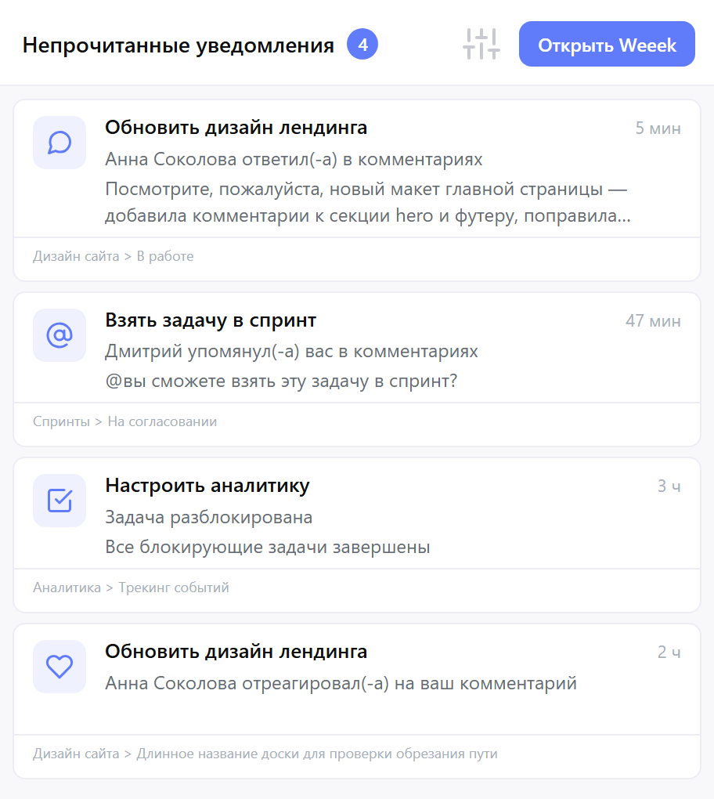
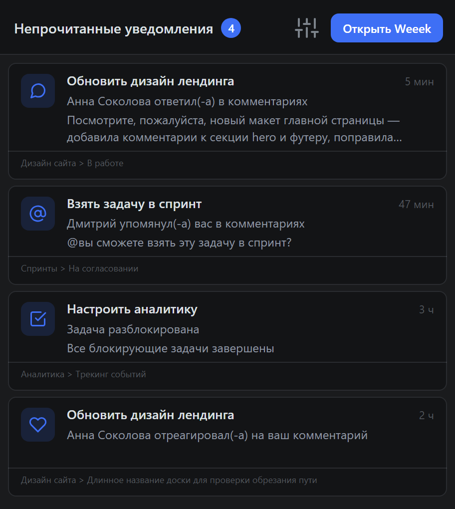

# Checker for Weeek

**Неофициальное** расширение для Chromium-браузеров (Microsoft Edge, Chrome, Opera и другие): счётчик непрочитанных уведомлений [app.weeek.net](https://app.weeek.net) на иконке панели и список непрочитанных в попапе с переходом к задаче.

- Версия: **1.0.0** · 2026-11-17

| Светлая тема | Тёмная тема |
| --- | --- |
|  |  |

## Возможности

- Счётчик непрочитанных на иконке панели (акцентный цвет `#6C78F4`, «99+» после сотни)
- Список непрочитанных в попапе: название задачи, «кто и что сделал», текст, путь «Проект > Доска > Колонка»
- Клик по плитке или тосту — уведомление помечается прочитанным, задача открывается в новой вкладке
- Меню «⋯» на плитке — «Прочитать» / «Архивировать» без открытия вкладки
- Собственный звук уведомления и системный тост Windows при новых уведомлениях
- Настройки прямо в попапе (кнопка настроек в шапке): интервал проверки, тема оформления (системная / светлая / тёмная), звук, тосты, путь до задачи

**Показ попапа ничего не помечает прочитанным** — при показе выполняются только GET-запросы; чтение — всегда осознанный клик пользователя.

## Быстрый старт

1. Страница расширений: `edge://extensions` (Edge), `chrome://extensions` (Chrome), `opera://extensions` (Opera) → включить **Режим разработчика**
2. **Загрузить распакованное** → выбрать папку `extension`
3. Войти в [app.weeek.net](https://app.weeek.net) — уведомления появятся в течение полуминуты

Отдельной авторизации нет — расширение использует вашу сессию сайта. Проверка новых уведомлений: по интервалу из настроек (по умолчанию раз в 30 секунд) + при открытии попапа.

## Документация

- 📘 Полная документация (RU): [docs/README.md](docs/README.md) — установка, настройки, как работает, используемые API
- 🤝 Технический хендофф (EN): [docs/HANDOFF.md](docs/HANDOFF.md) — архитектура, формат API, рецепты
- 🔒 Политика конфиденциальности: [PRIVACY.md](PRIVACY.md)
- ⚖️ Права и сторонние компоненты: [NOTICE](NOTICE)

## Структура

```
extension/   — расширение (загружается в Chromium-браузере): manifest, background, popup, offscreen, sounds, icons
docs/        — документация и технический хендофф
assets/      — скриншоты README и вектор собственного знака (logo-w.svg)
tests/       — тесты: Python-проверки структуры и HTML-раннеры JS в браузерном движке
LICENSE      — MIT
NOTICE       — авторские права и сторонние компоненты (Feather Icons)
PRIVACY.md   — политика конфиденциальности
```

## Тесты

Python (stdlib, без зависимостей):

```bash
python -I -m unittest discover -s tests -v
```

Браузерные раннеры (настоящий JS-код в движке Edge/Chromium):

```bash
python -m http.server 8741   # из корня репозитория
# http://127.0.0.1:8741/tests/runner-background.html  — парсинг уведомлений
# http://127.0.0.1:8741/tests/runner-popup.html       — логика попапа
# http://127.0.0.1:8741/tests/runner-offscreen.html   — воспроизведение звука
```

Подробнее — [tests/README.md](tests/README.md).

## Релизы

Готовые ZIP-пакеты версий — на странице [Releases](../../releases).

## Правовая информация

### Лицензия на код и собственные ассеты

Код проекта (`extension/`, `tests/`, документация), собственная иконка приложения (знак «W»: [`assets/logo-w.svg`](assets/logo-w.svg) и PNG в `extension/icons/`) и собственный звук уведомления (`extension/sounds/notification.wav`) распространяются по лицензии [MIT](LICENSE).

### Сторонние компоненты

- Иконки интерфейса основаны на [Feather Icons](https://feathericons.com) (MIT). Полный текст лицензии Cole Bemis и список использованных иконок — в файле [NOTICE](NOTICE).
- Названия Microsoft Edge, Chrome, Opera и Chromium принадлежат своим правообладателям и упоминаются только для обозначения совместимости.

### Товарный знак

**Это неофициальное расширение.** Оно не связано с сервисом [app.weeek.net](https://app.weeek.net) и не одобрено его командой. Название сервиса используется исключительно для указания совместимости и **не покрывается** лицензией MIT.

### API и условия использования

Расширение использует cookie-авторизованный API `api.weeek.net` с сессионными cookies пользователя. Пользователь устанавливает и использует расширение на свой риск. Проект не запрашивает логин и пароль: авторизация происходит через обычную сессию сайта в браузере.

Внутренний API не документирован, отдельной лицензии на него нет. [Условия использования Платформы Weeek](https://weeek.net/ru/documents/useofagreement) разрешают доступ «через Сайт или Приложение» (п. 3.5) и запрещают «иные способы использования, не указанные в Соглашении» (п. 3.6). Браузерное расширение — сторонний клиент: формально он не входит в этот перечень. Прямого запрета на расширения в п. 4.9 нет, но там же есть «не нарушать нормальную работу сайта» (п. 4.9.7) — поэтому опрос по умолчанию раз в 30 секунд, а не чаще. Использование расширения — на риск пользователя; лицензия MIT не покрывает бренд Weeek и внутренний API.

### Приватность

Подробная политика — в [PRIVACY.md](PRIVACY.md). Кратко: расширение не имеет аналитики, телеметрии и собственных серверов; запросы выполняются только к `api.weeek.net` и `app.weeek.net` с вашими сессионными cookies; настройки и кэш хранятся локально в браузере (`chrome.storage.sync` / `chrome.storage.session`); никакие данные не отправляются разработчику или третьим лицам.

### Отказ от ответственности

Расширение поставляется «как есть» в соответствии с лицензией MIT. Автор не связан с сервисом app.weeek.net, не гарантирует корректную работу при изменении API и не несёт ответственности за возможные последствия использования.
